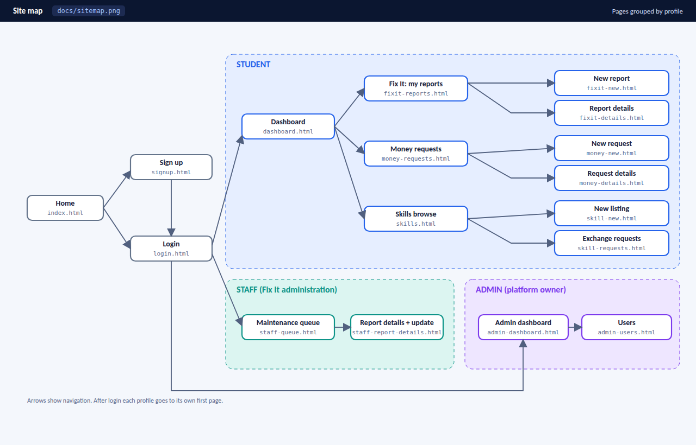

# Team Unipedia -- Task Plan (Lab 2)

Project: **Unipedia** -- University Residence Services Platform (Fix It, Money Request, Skills Exchange)

## Team members

| Member | GitHub username | Role |
|--------|-----------------|------|
| Abdullah Kotbi | @abdullahKtbi | Home, authentication and student dashboard pages |
| Chaima Chakrar | @chaimachakrar | Fix It (student) pages |
| Malak Ghedjati | @malakghedjati123 | Template, Fix It (staff) and admin pages |
| Achraf Bessaid Arslane | @bessaidashraf-alt | Money Request pages |
| Meriem Zaidi | @meriemzaidi00 | Skills Exchange pages |

## Profiles

- **Student**: residence student, uses Fix It, Money Request and Skills Exchange.
- **Staff**: residence maintenance administration, handles Fix It reports.
- **Admin**: platform owner (a team member), manages user accounts.

## Site map

## Conventions

- Folders: HTML pages at the root, `docs/` for documentation and images.
- File names: lowercase, hyphens, English (example: `fixit-new.html`).
- Every page starts from `template.html` (header with navigation, main, footer).
- Branches: `page/<page-name>` (example: `page/money-new`).
- Commit messages: imperative (example: "Add money request form").
- Each page has one owner and a different reviewer; a page is merged only after the reviewer approves its pull request.
- Only edit your own pages and your own row in this file.

## Pages

| Page | File | Profile | Owner | Reviewer | Status |
|------|------|---------|-------|----------|--------|
| Home | index.html | all | @abdullahKtbi | @bessaidashraf-alt | To do |
| Login (form) | login.html | all | @abdullahKtbi | @bessaidashraf-alt | To do |
| Sign up (form) | signup.html | all | @abdullahKtbi | @bessaidashraf-alt | To do |
| Student dashboard | dashboard.html | student | @abdullahKtbi | @bessaidashraf-alt | To do |
| Fix It: new report (form) | fixit-new.html | student | @chaimachakrar | @malakghedjati123 | To do |
| Fix It: my reports (table) | fixit-reports.html | student | @chaimachakrar | @malakghedjati123 | To do |
| Fix It: report details | fixit-details.html | student | @chaimachakrar | @malakghedjati123 | To do |
| Template | template.html | all | @malakghedjati123 | @chaimachakrar | To do |
| Staff: maintenance queue (table) | staff-queue.html | staff | @malakghedjati123 | @chaimachakrar | To do |
| Staff: report details and status update (form) | staff-report-details.html | staff | @malakghedjati123 | @chaimachakrar | To do |
| Admin: dashboard | admin-dashboard.html | admin | @malakghedjati123 | @chaimachakrar | To do |
| Admin: users (table) | admin-users.html | admin | @malakghedjati123 | @chaimachakrar | To do |
| Money: requests (table) | money-requests.html | student | @bessaidashraf-alt | @meriemzaidi00 | To do |
| Money: new request (form) | money-new.html | student | @bessaidashraf-alt | @meriemzaidi00 | To do |
| Money: request details | money-details.html | student | @bessaidashraf-alt | @meriemzaidi00 | To do |
| Skills: new listing (form) | skill-new.html | student | @meriemzaidi00 | @abdullahKtbi | To do |
| Skills: browse | skills.html | student | @meriemzaidi00 | @abdullahKtbi | To do |
| Skills: exchange requests (table) | skill-requests.html | student | @meriemzaidi00 | @abdullahKtbi | To do |

Status values: To do , In progress , In review , Done (#PR number).

## Deadlines

- Template pushed: 27/10/2026
- All pages merged: 27/10/2026
- Tag `lab2-team` on the final commit: 28/10/2026

## Confirmation

Each member confirms their assignment by ticking their name:

- [ ] Abdullah Kotbi
- [ ] Chaima Chakrar
- [ ] Malak Ghedjati
- [ ] Achraf Bessaid Arslane
- [ ] Meriem Zaidi
